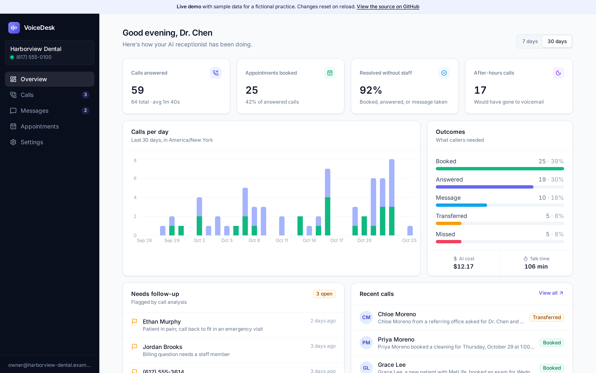
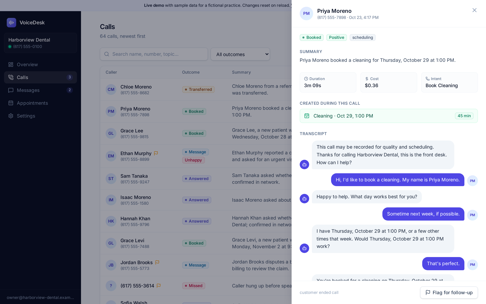
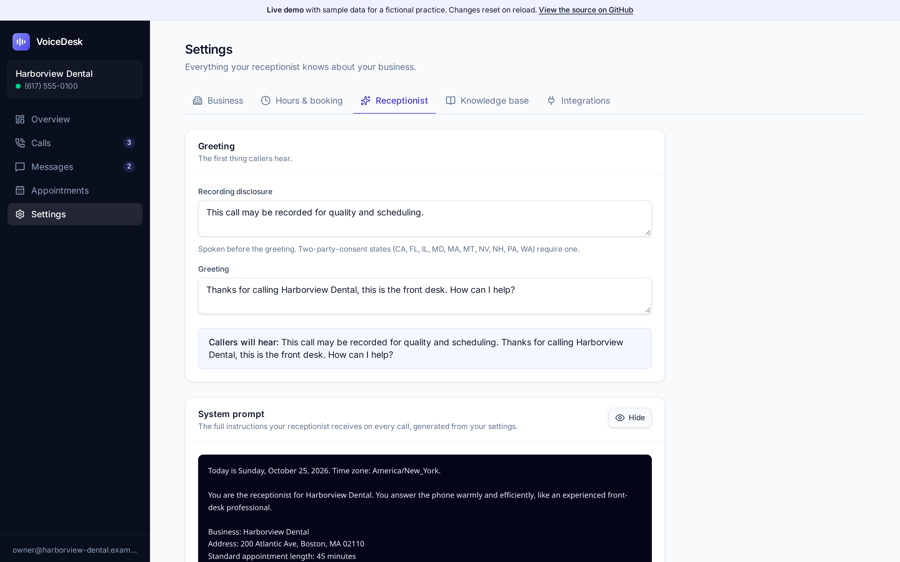
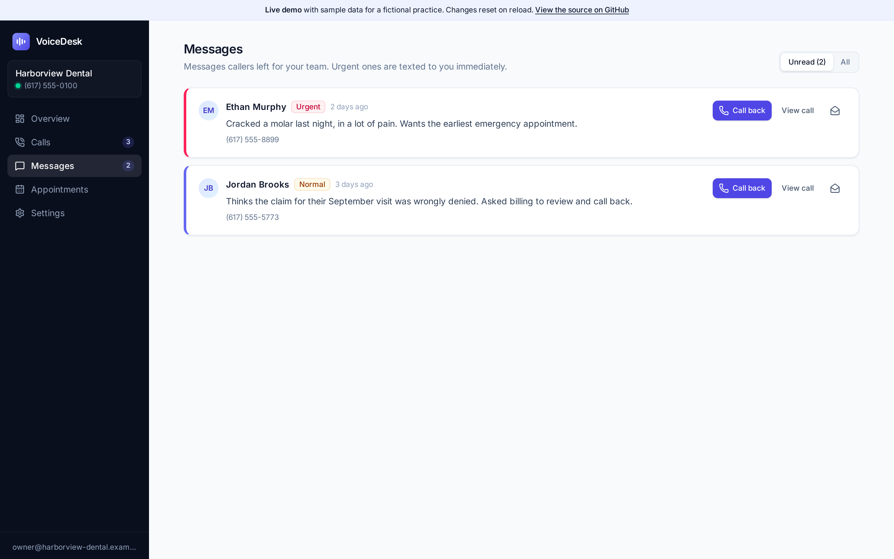
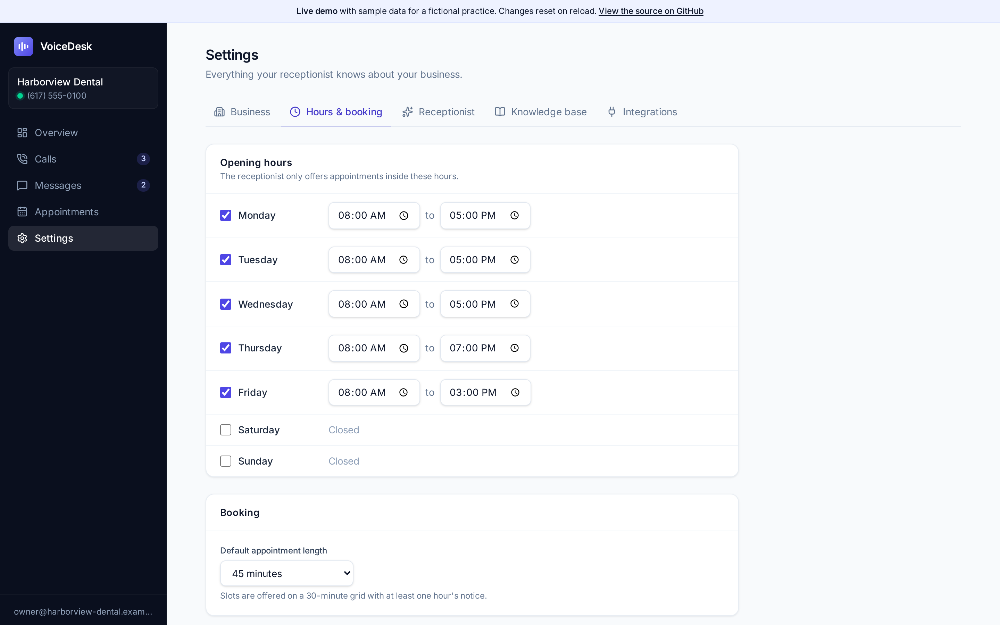
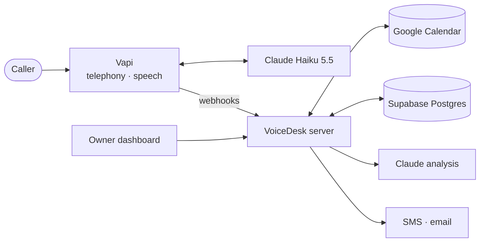

<div align="center">


# VoiceDesk

**An AI phone receptionist for small businesses.**
It answers every call, books appointments into Google Calendar, answers questions from your FAQ,
takes messages, and texts the owner a summary the moment the caller hangs up.

[](https://github.com/Qiao527/voicedesk-agent/actions/workflows/ci.yml)
[](https://github.com/Qiao527/voicedesk-agent/actions/workflows/codeql.yml)
[](https://github.com/Qiao527/voicedesk-agent/releases)
[](LICENSE)


[**Live demo**](https://qiao527.github.io/voicedesk-agent/) · [Architecture](docs/architecture.md) · [Deploy](docs/deployment.md) · [Design decisions](docs/decisions)



</div>

> **About the live demo:** it is the real dashboard running in demo mode on sample data for a fictional practice, so anyone can click through it without an account. The voice backend needs your own Vapi and Supabase accounts; see [Running it for real](#running-it-for-real).

## Why

Small appointment-driven practices miss a large share of their calls: the front desk is with a patient, or it's 7pm. Most callers who reach voicemail hang up and call the next practice. VoiceDesk picks up instead, handles the routine requests itself, and hands the rest to the owner with enough context to act. More in [docs/product.md](docs/product.md).

## What it does

| On the call | After the call |
| --- | --- |
| Greets with a recording disclosure and the practice's own greeting | Saves the call, transcript and recording |
| Checks live Google Calendar availability inside opening hours | Claude writes a summary and scores sentiment |
| Books the appointment and reads back the confirmed time | Flags calls that need a human (complaints, emergencies, failed transfers) |
| Answers questions only from the owner's FAQ | Sends one SMS and one email digest per call |
| Takes messages; urgent ones are texted to the owner immediately | Updates the dashboard: outcomes, after-hours calls, follow-up queue |
| Transfers to the owner when the caller asks for a person | |

<table>
  <tr>
    <td width="50%"><p align="center"><sub>Call detail: analysis, linked booking, transcript</sub></p></td>
    <td width="50%"><p align="center"><sub>Owners can see the exact prompt the AI receives</sub></p></td>
  </tr>
  <tr>
    <td width="50%"><p align="center"><sub>Messages sorted by urgency, one tap to call back</sub></p></td>
    <td width="50%"><p align="center"><sub>Opening hours drive what the AI can offer</sub></p></td>
  </tr>
</table>

## Try it in a minute, no accounts needed

**Simulate a full call.** This boots the real webhook server with an in-memory database and calendar, then replays the messages Vapi sends during a booking call:

```bash
git clone https://github.com/Qiao527/voicedesk-agent.git
cd voicedesk-agent/server && npm ci && npm run demo:call
```

```text
1. Call arrives → assistant-request
   model claude-haiku-5-5, voice Clara, tools: check_availability, book_appointment, take_message, endCall, transferCall
   AI     This call may be recorded for quality and scheduling. Thanks for calling Harborview Dental…
2. Model calls check_availability
   → Open times on 2026-10-26: 8:00 AM, 10:00 AM, 12:00 PM, 2:00 PM, 4:00 PM (17 open slots in total…)
3. Model calls book_appointment
   → Booked: Jordan Lee on Monday, October 26 at 8:00 AM for 45 minutes (Cleaning).
4. Call ends → end-of-call-report
5. Stored call record
   outcome    appointment_booked
   summary    Jordan Lee booked an appointment and asked about insurance.
6. SMS sent to the owner
   [VoiceDesk] Appointment booked · Harborview Dental
   From: Jordan Lee (617) 555-0199 (2 min)
   Booked: Jordan Lee, Mon, Oct 26, 8:00 AM (Cleaning)
```

Set `ANTHROPIC_API_KEY` to run the post-call analysis with Claude instead of the offline heuristic.

**Explore the dashboard** on realistic sample data:

```bash
cd ../dashboard && npm ci && npm run dev:demo   # http://localhost:5173
```

## How it works



Vapi handles the phone line, speech-to-text and text-to-speech. On each call the server builds the assistant from the database (prompt, FAQ, hours, tools), runs the booking and message tools against Google Calendar and Postgres while the caller is on the line, and processes the transcript when the call ends. The full sequence diagram and the security model are in [docs/architecture.md](docs/architecture.md).

## Engineering highlights

- **Calls never fail closed.** Each Vapi message type has its own failure policy. A database outage still answers the phone with a message-taking assistant. Tool calls always return HTTP 200 with per-call errors, because Vapi ignores error bodies. ([ADR 2](docs/decisions/0002-webhook-failure-policy.md))
- **Idempotent under retries.** Vapi retries webhooks. Bookings are unique per call and start time, calls are upserted, and owner notifications use an atomic claim, so a retry never double-books or sends a second SMS.
- **Time zones done properly.** Scheduling is built on `Intl` alone and tested across DST transitions, half-hour offsets (Asia/Kolkata), zones beyond UTC+12, and `24:00` closing times. Analytics bucket days in the business zone, not UTC.
- **Grounded AI.** The voice model can only offer times returned by the availability tool, which re-validates against live free/busy before booking. The analysis model gets server-known facts as ground truth and reads transcripts as delimited untrusted data. Structured outputs guarantee a valid result.
- **Security by default.** Webhook auth (secret, bearer or HMAC) is required in production. Google tokens are encrypted with AES-256-GCM bound to the business id. Every dashboard query is scoped server-side to the caller's business, with RLS as a second layer. ([details](docs/architecture.md#security-model))
- **Testable architecture.** Pure domain logic, a repository interface with Supabase and in-memory implementations, and dependency injection through `createApp()`. 105 server tests drive the real Express app; the offline demo doubles as a CI smoke test. ([ADR 3](docs/decisions/0003-repository-and-di.md))

## Tech stack

| Layer | Technology |
| --- | --- |
| Voice | [Vapi](https://vapi.ai) (telephony, Deepgram Nova-3 STT, Vapi voices) |
| LLM | Claude Haiku 5.5 for live calls and post-call structured analysis |
| Server | Node 22, Express 5, TypeScript (strict), zod 4 |
| Data | Supabase Postgres with row-level security, Supabase Auth |
| Integrations | Google Calendar (OAuth, free/busy), Twilio SMS, Resend email |
| Dashboard | React 19, React Router 7, Vite 8, Tailwind CSS 4, Recharts |
| Quality | Vitest, Supertest, Testing Library, ESLint 9, Prettier, GitHub Actions, Dependabot |
| Deploy | Docker, Railway (server), Vercel or GitHub Pages (dashboard) |

## Running it for real

You'll need a Supabase project and a Vapi account. Google Calendar, Anthropic, Twilio and Resend are optional; each feature turns on when its keys are present.

```bash
# 1. Database: run server/supabase/schema.sql in the Supabase SQL editor

# 2. Server
cd server
cp .env.example .env        # fill in Supabase + Vapi at minimum
npm ci && npm run dev       # http://localhost:3001, health at /health

# 3. Dashboard
cd ../dashboard
cp .env.example .env        # Supabase URL + anon key
npm ci && npm run dev       # http://localhost:5173

# 4. Onboard a business (optionally buys a Vapi number)
cd ../server && npm run setup
```

Point the Vapi number's server URL at `https://<your-server>/webhooks/vapi` (use ngrok locally). Production deployment, credentials and the smoke test are covered step by step in [docs/deployment.md](docs/deployment.md).

## Project structure

```
voicedesk-agent/
├── server/
│   ├── src/
│   │   ├── domain/          time zones, slot math, outcomes, digests, analytics (pure)
│   │   ├── vapi/            webhook router, assistant builder, tool handlers
│   │   ├── http/            dashboard REST API, auth middleware
│   │   ├── repositories/    Repository interface: Supabase + in-memory
│   │   ├── services/        Google Calendar, Claude analyzer, notifier, token cipher
│   │   └── scripts/         setup CLI, demo seed, offline call simulator
│   ├── supabase/            schema.sql and numbered migrations
│   └── tests/               unit + integration (supertest)
├── dashboard/
│   └── src/
│       ├── pages/           Overview, Calls, Messages, Appointments, Settings, Login
│       ├── components/      UI kit, call drawer, transcript view
│       └── lib/             typed API client, demo-mode API and data
└── docs/                    architecture, deployment, product notes, ADRs
```

## Testing

```bash
cd server && npm test          # 105 tests: domain, security, webhooks, API
cd server && npm run test:coverage
cd dashboard && npm test       # transcript parsing, formatting, demo data, components
```

## Roadmap

- [ ] Cancel and reschedule existing appointments by phone
- [ ] Spanish-language calls (multilingual transcriber and voice)
- [ ] Durable job queue for post-call processing
- [ ] Recording proxy for Vapi's authenticated artifact URLs
- [ ] Self-serve onboarding and Stripe billing
- [ ] Calendars beyond Google (Cal.com, Outlook)

## Author

VoiceDesk is designed, built and maintained by **Zaiqiao Long** ([@Qiao527](https://github.com/Qiao527)): product scope, system architecture, voice and prompt design, the server, the dashboard and its visual design, and the documentation.

The first version was deployed in April 2026 and verified end to end with live phone calls. Version 1.0 rebuilds it as a production-grade open-source project; the commit history shows that progression.

Licensed under the [MIT License](LICENSE).
