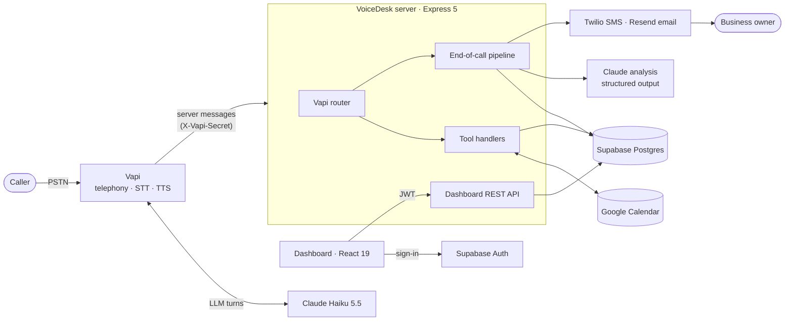
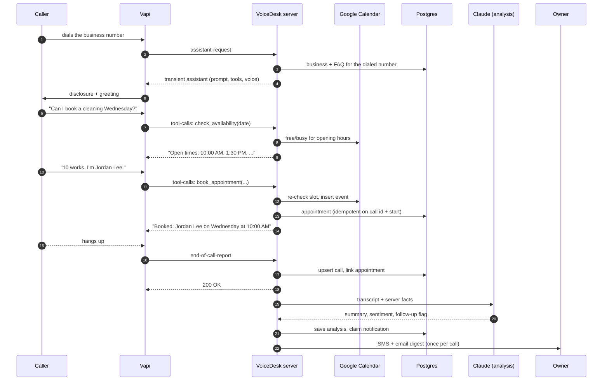

# Architecture

VoiceDesk has two deployable parts: a webhook server that Vapi calls during every phone call, and a static dashboard for business owners. Supabase is the system of record and also provides dashboard authentication.



## A call, step by step



## Server layout

```
server/src
├── app.ts                 createApp(deps): middleware, routes, error handling
├── index.ts               production wiring (Supabase, Google, Twilio, Claude)
├── config/env.ts          zod-validated configuration
├── domain/                pure logic, no I/O
│   ├── time.ts            time-zone math (DST, half-hour offsets, 24:00)
│   ├── scheduling.ts      slot generation and booking validation
│   ├── outcome.ts         call outcome and transfer classification
│   ├── notifications.ts   SMS and HTML email rendering
│   └── analytics.ts       dashboard aggregates in the business time zone
├── repositories/          Repository interface + Supabase and in-memory versions
├── services/              Google Calendar, Claude analyzer, notifier, crypto
├── vapi/                  webhook router, assistant builder, tool handlers
└── http/                  dashboard API routes and auth middleware
```

Dependencies flow inward. `domain/` imports nothing with side effects. Route handlers and the webhook pipeline depend on the `Repository`, `CalendarProvider`, `Notifier` and `CallAnalyzer` interfaces, never on Supabase or Google directly. `createApp()` receives every implementation, so the test suite and `npm run demo:call` run the real HTTP stack against in-memory versions.

## Design decisions

The reasoning behind the non-obvious choices is recorded in [`docs/decisions`](decisions):

1. [Transient assistants instead of saved Vapi assistants](decisions/0001-transient-assistants.md)
2. [Webhook failure policy per message type](decisions/0002-webhook-failure-policy.md)
3. [Repository interface and dependency injection](decisions/0003-repository-and-di.md)
4. [Encrypting Google tokens at rest](decisions/0004-token-encryption.md)
5. [Model choice for voice and analysis](decisions/0005-model-choice.md)

## Data model

| Table          | Purpose                                                                 |
| -------------- | ----------------------------------------------------------------------- |
| `businesses`   | One row per client: hours, greeting, owner contacts, Vapi number, tokens |
| `calls`        | One row per Vapi call. Unique on `vapi_call_id` for idempotent upserts   |
| `appointments` | Bookings. Unique on `(_vapi_call_id, start_time)` so retries can't double-book |
| `messages`     | Messages for the owner, with urgency                                     |
| `faq_items`    | The knowledge base injected into the system prompt                       |

`_vapi_call_id` links appointments and messages created mid-call to the call row, which only exists after the end-of-call report arrives.

The schema lives in [`server/supabase/schema.sql`](../server/supabase/schema.sql), with forward migrations in [`server/supabase/migrations`](../server/supabase/migrations). Both paths (fresh install, and upgrading from the original schema) are checked against Postgres before release.

## Security model

| Boundary                   | Control                                                                          |
| -------------------------- | -------------------------------------------------------------------------------- |
| Vapi → server              | Shared secret (`X-Vapi-Secret` or `Authorization: Bearer`) or HMAC body signature, constant-time compare. Required in production. |
| Dashboard → server         | Supabase JWT verified per request. Every query is scoped by the business the user owns; no endpoint accepts a business id from the client. |
| Google OAuth callback      | HMAC-signed, 10-minute `state` binding business and user. The callback re-checks ownership. |
| Data at rest               | Google tokens sealed with AES-256-GCM, with the business id as associated data. RLS policies on every table as defense in depth. |
| Untrusted text             | Transcripts are passed to the analyzer as delimited data with an explicit "ignore instructions" rule. Owner emails escape all caller-provided text. |
| HTTP                       | Helmet headers, CORS allow-list, per-IP rate limits, body size limits, generic 500 responses. |
| Logs                       | Structured JSON. Phone numbers are masked; transcripts and tokens are never logged. |
